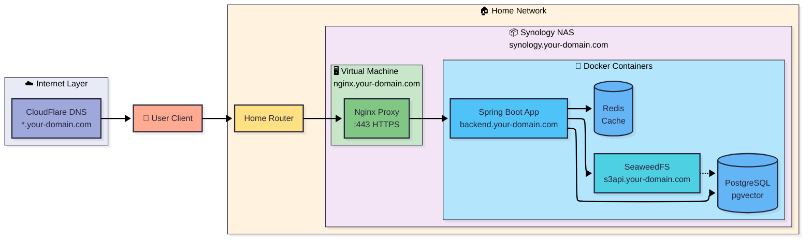
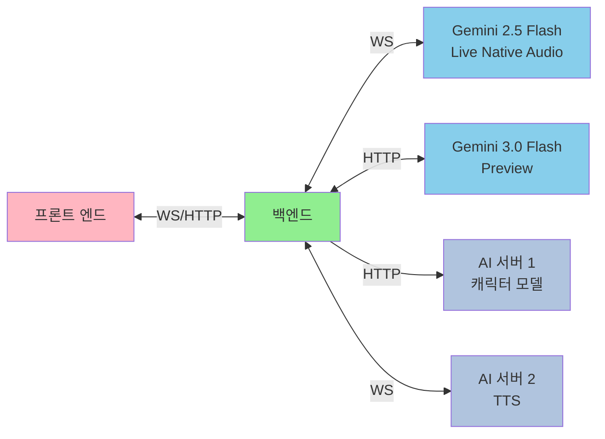
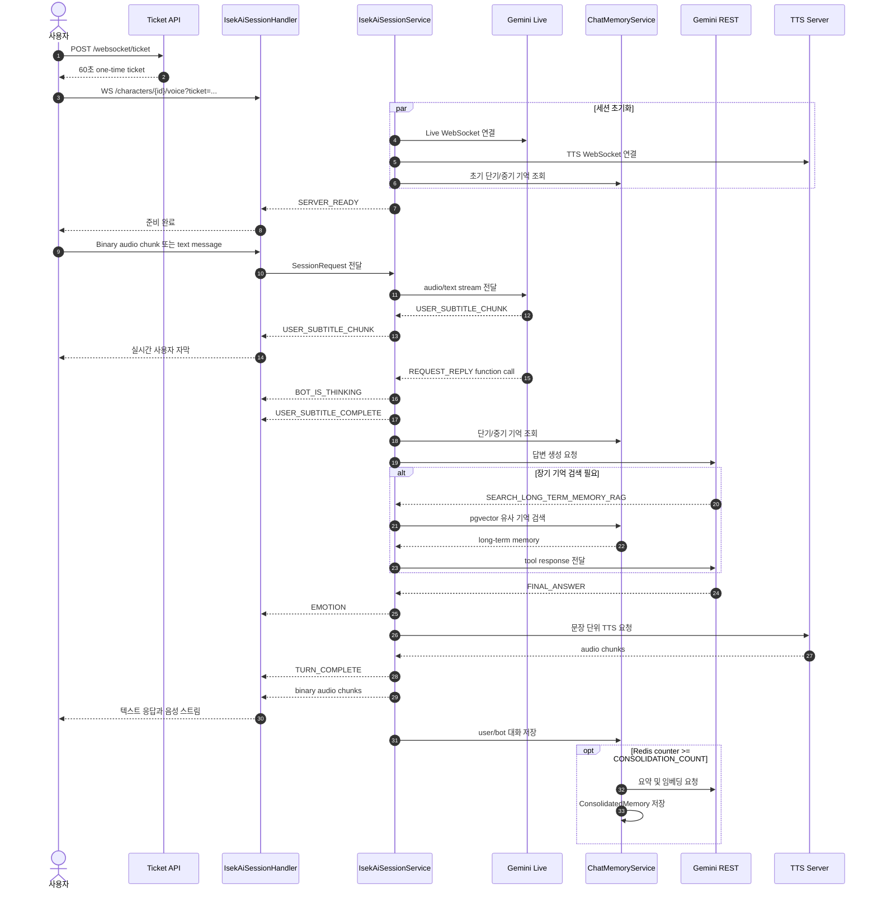
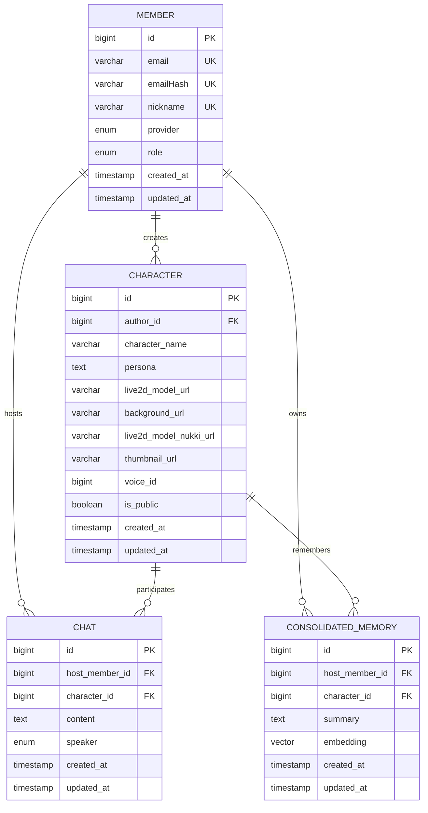
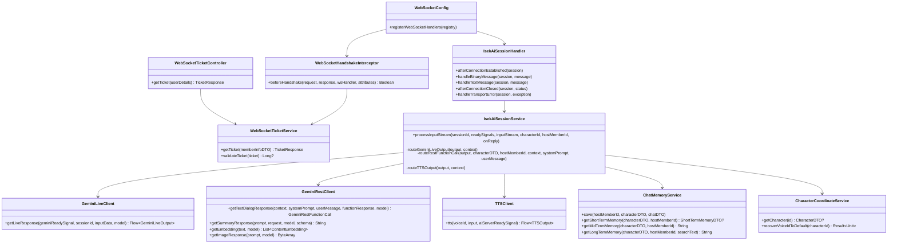

# ISEKAI-BE

몰입형 AI 캐릭터 채팅 서비스의 백엔드 서버입니다.


## 프로젝트 개요

ISEKAI-BE는 사용자가 생성한 AI 캐릭터와 텍스트 또는 실시간 음성으로 대화할 수 있게 하는 Spring Boot 기반 백엔드입니다.

주요 흐름은 다음과 같습니다.

- 캐릭터 생성 요청을 외부 AI 서버와 Gemini 이미지 생성으로 처리합니다.
- 캐릭터 리소스는 S3 호환 스토리지에 preview/persisted 단계로 저장합니다.
- 음성 WebSocket 세션에서 Gemini Live가 사용자 발화를 감지하고 STT 청크를 반환합니다.
- 응답이 필요하면 Gemini REST가 페르소나, 단기 기억, 중기 기억, 장기 기억 RAG를 바탕으로 답변을 생성합니다.
- TTS 서버가 답변 문장을 음성 스트림으로 변환합니다.
- 대화 기록은 PostgreSQL에 저장하고, 일정 횟수마다 요약과 임베딩을 생성해 장기 기억으로 보관합니다.

## 기술 스택

| 영역 | 기술 |
| --- | --- |
| Language | Kotlin 2.2.0, Java 21 |
| Framework | Spring Boot 3.5.4, Spring MVC, Spring WebSocket |
| Security | Spring Security, OAuth2 Client, JWT |
| Async | Kotlin Coroutines, Reactor |
| Database | PostgreSQL, pgvector, Spring Data JPA, Hibernate Vector |
| Cache | Redis |
| AI | Google GenAI SDK, Gemini Live, Gemini REST |
| Storage | S3-compatible API, Spring Cloud AWS S3 |
| Build | Gradle |

## 주요 기능

### 캐릭터 생성

- `POST /characters/live2d`로 Live2D 생성 작업을 외부 AI 서버에 요청합니다.
- `POST /characters/background-image`로 Gemini 이미지 모델을 사용해 배경 이미지를 생성합니다.
- `POST /characters/confirm`에서 preview 파일을 persisted 위치로 복사하고 캐릭터를 생성합니다.
- 배경 이미지와 누끼 이미지를 합성해 1024x1024 썸네일을 생성합니다.
- 확정 중 오류가 발생하면 이미 복사된 persisted 파일을 비동기로 삭제합니다.

### 실시간 대화 세션

- WebSocket 엔드포인트는 `/characters/{characterId}/voice?ticket={ticket}`입니다.
- WebSocket 접속 전 `POST /websocket/ticket`으로 Redis 기반 one-time ticket을 발급받습니다.
- ticket TTL은 60초이며, 검증 시 즉시 삭제됩니다.
- Binary WebSocket 메시지는 16 kHz PCM 오디오 청크로 Gemini Live에 전달됩니다.
- Text WebSocket 메시지는 `SessionTextRequest`로 파싱되어 텍스트 입력으로 처리됩니다.

### 기억 시스템

- 한 턴은 사용자 메시지와 캐릭터 응답을 각각 `USER`, `BOT` 채팅 행으로 저장합니다.
- 최근 대화는 단기 기억으로 조회합니다.
- Redis 카운터가 `CONSOLIDATION_COUNT`에 도달하면 최근 대화를 요약해 중장기 기억으로 저장합니다.
- 요약된 기억은 768차원 임베딩으로 저장하고, pgvector 거리 연산으로 유사 기억을 검색합니다.

### 인증과 보안

- Kakao OAuth2 로그인을 사용합니다.
- JWT 필터로 HTTP 요청 인증을 처리합니다.
- WebSocket은 HTTP 인증 토큰을 직접 유지하지 않고 Redis ticket으로 handshaking합니다.
- CORS 허용 origin, OAuth redirect, JWT/AES 키는 `application-security.yml`과 환경 변수로 관리합니다.

## 🔍 아키텍처 다이어그램

### 1. 백엔드 시스템 아키텍처 (Backend System Architecture)



### 2. 프로젝트 아키텍처 (Service Architecture)



## 🔄 데이터 흐름 (Data Flow)

실시간 음성 대화 한 턴의 주요 흐름입니다.



## 💾 데이터베이스 설계 (ER Diagram)



## 🧩 웹소켓 클래스 구조 (WebSocket Class Diagram)



## 주요 패키지

| 패키지 | 역할 |
| --- | --- |
| `session` | WebSocket 음성/텍스트 세션 처리 |
| `gemini` | Gemini Live/REST 클라이언트, 함수 선언, 스키마, 응답 파서 |
| `chat` | 채팅 저장, 단기/중기/장기 기억, pgvector RAG |
| `character` | 캐릭터 생성, 배경 이미지 생성, 캐릭터 조회/삭제 |
| `aiServer` | 외부 AI 서버 REST/TTS WebSocket 연동 |
| `common/security` | OAuth2, JWT, CORS, redirect 검증 |
| `common/websocket` | WebSocket ticket 발급과 handshake 검증 |
| `common/s3` | S3 호환 스토리지 파일 관리 |
| `member` | 회원 조회, OAuth 사용자 정보 매핑 |

## 실행 요구사항

- JDK 21
- PostgreSQL과 pgvector 확장
- Redis
- Google AI Studio API Key
- Kakao OAuth2 애플리케이션
- 캐릭터 생성용 외부 AI 서버
- TTS WebSocket 서버
- S3 호환 스토리지

dev 프로필은 기본적으로 다음 주소를 사용합니다.

| 리소스 | 기본값 |
| --- | --- |
| Backend port | `18081` |
| PostgreSQL | `jdbc:postgresql://localhost:15432/isekai` |
| Redis | `localhost:16379` |

## 환경 변수

루트에 `.env` 파일을 만들고 필요한 값을 설정합니다. `spring-dotenv`가 환경 변수를 로드합니다.

```properties
# Application
JWT_SECRET_KEY=
AES256_KEY=

# Gemini
GEMINI_API_KEY=

# External AI servers
AI_SERVER_WEBSOCKET_URL=
AI_SERVER_REST_URL=

# Kakao OAuth2
KAKAO_CLIENT_ID=
KAKAO_CLIENT_SECRET=

# S3-compatible storage
CLOUD_STORAGE_HOST=
CLOUD_STORAGE_PUBLIC_URL=
CLOUD_STORAGE_PORT=443
CLOUD_STORAGE_BUCKET_NAME=
CLOUD_STORAGE_REGION=
CLOUD_STORAGE_ACCESS_KEY=
CLOUD_STORAGE_SECRET_KEY=

# Development
DEV_URL=

# Production
PROD_URL=
PROD_POSTGRES_URL=
PROD_POSTGRES_PORT=
PROD_POSTGRES_USERNAME=
PROD_POSTGRES_PASSWORD=
PROD_REDIS_URL=
PROD_REDIS_PORT=
PROD_REDIS_PASSWORD=
PROD_REDIS_DATABASE=
```

## 로컬 실행

Windows:

```powershell
.\gradlew.bat bootRun
```

macOS/Linux:

```bash
./gradlew bootRun
```

프로필을 명시하려면 다음처럼 실행합니다.

```powershell
.\gradlew.bat bootRun --args='--spring.profiles.active=dev'
```

## 검증

Windows:

```powershell
.\gradlew.bat compileKotlin compileJava
.\gradlew.bat test
```

macOS/Linux:

```bash
./gradlew compileKotlin compileJava
./gradlew test
```

외부 서비스에 의존하는 기능은 로컬 PostgreSQL, Redis, Gemini API, AI 서버, S3 호환 스토리지 설정이 준비되어야 정상 동작합니다.

## REST API 요약

| Method | Path | 설명 |
| --- | --- | --- |
| `POST` | `/characters/live2d` | Live2D 캐릭터 생성 요청 |
| `POST` | `/characters/background-image` | 배경 이미지 생성 |
| `POST` | `/characters/confirm` | 캐릭터 생성 확정 |
| `GET` | `/characters` | 공개 캐릭터 목록 조회 |
| `GET` | `/characters/{id}` | 캐릭터 상세 조회 |
| `DELETE` | `/characters/{id}` | 캐릭터 삭제 |
| `GET` | `/characters/{characterId}/chats` | 캐릭터별 채팅 기록 조회 |
| `GET` | `/me` | 현재 로그인 사용자 조회 |
| `POST` | `/websocket/ticket` | WebSocket 접속 ticket 발급 |

## WebSocket 메시지

### 클라이언트 입력

- Binary message: 16 kHz PCM 오디오 청크
- Text message: `SessionTextRequest`

```json
{
  "messageType": "TEXT_MESSAGE",
  "content": {
    "@type": "textMessage",
    "text": "안녕하세요"
  }
}
```

### 서버 텍스트 응답 타입

| 타입 | 설명 |
| --- | --- |
| `SERVER_READY` | Gemini Live와 TTS 서버 준비 완료 |
| `USER_SUBTITLE_CHUNK` | 사용자 발화 STT 청크 |
| `USER_SUBTITLE_COMPLETE` | 최종 사용자 발화 |
| `BOT_IS_THINKING` | 답변 생성 시작 |
| `INTERRUPTED` | 이전 답변 생성 취소 |
| `TURN_COMPLETE` | 사용자 발화와 캐릭터 최종 텍스트 응답 |
| `EMOTION` | 캐릭터 감정 |
| `ERROR` | 세션 오류 |

서버 Binary 응답은 TTS 오디오 청크입니다.

## 설정 파일

| 파일 | 역할 |
| --- | --- |
| `application.yml` | 공통 설정, config import, virtual thread, AI 서버 URL, 서버 포트 |
| `application-dev.yml` | dev datasource, Redis, Kakao redirect |
| `application-prod.yml` | prod datasource, Redis, Kakao redirect |
| `config/application-security.yml` | OAuth2, CORS, redirect, JWT/AES |
| `config/application-gemini.yml` | Gemini API key와 Live silence 설정 |
| `config/application-prompt.yml` | 프롬프트 리소스 경로 |
| `config/application-cloud-storage.yml` | S3 호환 스토리지 설정 |

## 현재 한계와 주의사항

- 주요 기능은 Gemini, 외부 AI 서버, TTS 서버, Redis, PostgreSQL, S3 호환 스토리지에 의존합니다.
- dev 프로필은 `spring.jpa.hibernate.ddl-auto=create`를 사용하므로 로컬 DB 데이터가 재생성될 수 있습니다.
- prod 프로필은 `ddl-auto=update`를 사용하며, 별도 마이그레이션 도구는 현재 설정되어 있지 않습니다.
- WebSocket ticket은 Redis 기반 one-time ticket이므로 발급 후 60초 안에 사용해야 합니다.
- Gemini Live는 주변 제3자 대화와 사용자가 캐릭터에게 직접 말하는 상황을 완벽히 구분하지 못할 수 있습니다.
- TTS 음성은 외부 TTS 서버가 제공하는 voice id에 의존합니다. 존재하지 않는 voice id가 감지되면 기본 voice id로 복구를 시도합니다.
- 일부 E2E 테스트 코드는 외부 서비스 의존성이 크며, 현재 주석 처리된 부분이 있습니다.
